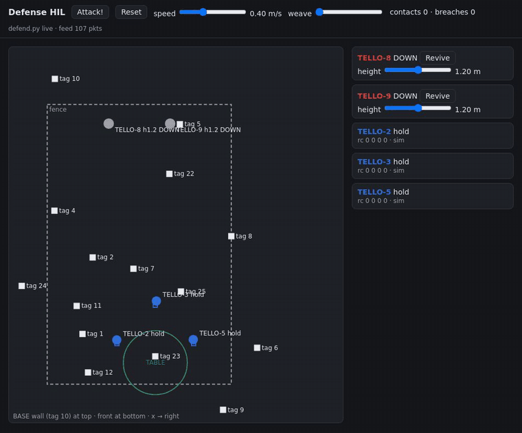
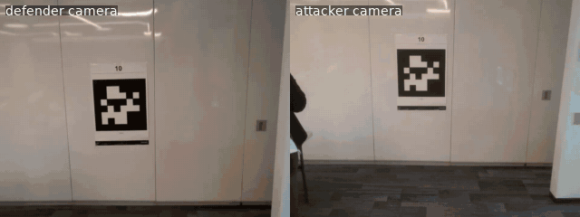
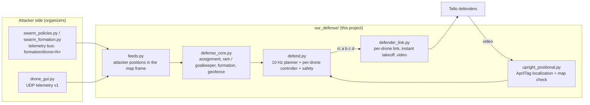
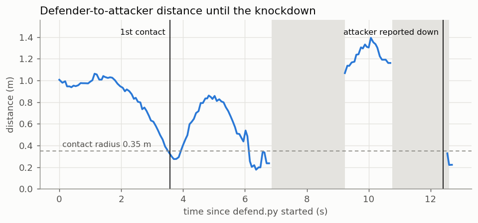
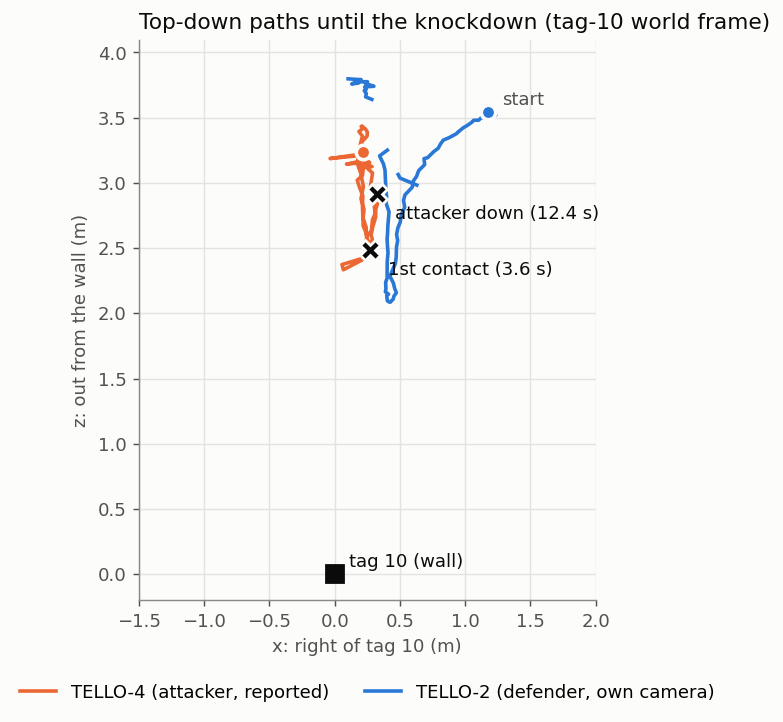
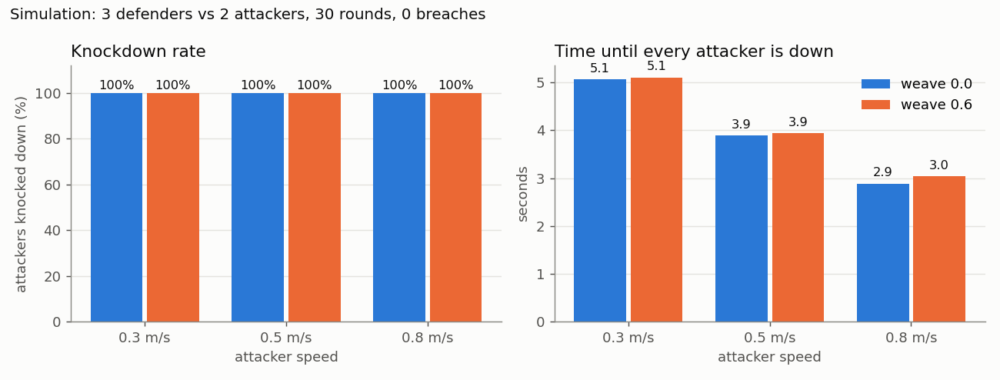

# Drone Swarm Defense

**Autonomous DJI Tello defenders that localize themselves from AprilTags, track an attacking drone swarm in real time and knock the attackers down.**

🥈 **Runner-up, Action Space anti-drone swarm defense hackathon (23–24 Oct 2026).** Ours was the only team whose defenders actually followed and chased the attacking drones.

[](https://github.com/DhyeyMistry/drone-swarm-defense/actions/workflows/tests.yml)

| Browser simulation: 3 defenders vs 2 attackers | Real flight: the defender knocks the attacker down |
|---|---|
|  |  |
| Blue defenders hold a V in front of the table (green circle). When the red attackers launch, the two outer defenders ram them while the middle one keeps goal. Then all three return to the V. | Left: the defender's camera, with the attacker right in front of tag 10. Right: the attacker's camera, hit, then on the carpet. |

**Team 5:** Dhyey Mistry · Frania Chettiar · Sai Jayakar Vanam · Alay Shah

---

## The problem

Protect a "data center" (a table) from attacking Tello drones, using our own Tellos as defenders. A defender only knocks an attacker out by physically hitting it: touching isn't enough.

What makes it hard:
- **No motor-level control.** A Tello only takes SDK commands: `takeoff`, `land`, and `rc a b c d` velocity sticks.
- **Localization comes only from the forward camera.** AprilTags on the walls and floor are the only reference.
- **The radio link is shaky**, with about 0.3 s of lag and video that sometimes drops.

## Three approaches

| | Approach | Highlights | Status |
|---|---|---|---|
| **1** | **AprilTag localization + telemetry pursuit** (flown at the competition): this README | Real Tellos knock attackers down; 60/60 knockdowns in the browser simulation | ✅ [code](drone_deployment_infra/our_defense/) · [results](docs/RESULTS.md) |
| **2** | **Sim-to-sim: coordinated pursuit + PPO residual**, built in MuJoCo and validated unchanged in Isaac Lab | **0% breaches over 800 episodes**, vs 75–89% for the provided greedy baseline | 📝 [approaches/sim_to_sim_rl](approaches/sim_to_sim_rl/), code coming soon |
| **3** | **Visual servo defense**: YOLO26 detection, depth-aware tracking, Social-GAN-style path forecasting | 100% / 91% detection (near / mid-range); 3/3 intercepts in simulation | 📝 [approaches/visual_servo](approaches/visual_servo/), code coming soon |

| MuJoCo coordinator + chase (approach 2) | Visual servo "Drone hunter" (approach 3) |
|---|---|
|  |  |

What the judges saw: [`docs/PRESENTATION.md`](docs/PRESENTATION.md).

## How it works (approach 1)



1. **Shared world frame.** Everything lives in the tag-10 frame of the room's `map.yaml`: x right of tag 10, y up, z out of its wall.
2. **Localization** (`upright_positional.py`). Each defender locates itself every frame from **any** mapped tag in view:
   - Each tag's pose is turned upright first, so the print orientation (official vs OpenCV-drawn tags) can never mirror the position.
   - A tag whose reading disagrees with tag 10 by more than 0.5 m (it was moved after mapping) is dropped for the rest of the flight.
3. **Attacker positions** (`feeds.py`). They're read from the organizers' telemetry:
   - the `swarm_policies.py` bus, already in map coordinates. Its hub is found automatically.
   - or `drone_gui`'s per-tag poses, converted through the same map, with height taken from each Tello's own sensor.

   Attackers are matched by drone name, or `auto`: anything that isn't ours.
4. **Launch** (`defender_link.py`). Every defender connects and **takes off independently, the moment it answers**: no waiting for the others or for video. It then climbs 30 cm and advances 50 cm toward tag 10 for a better view of the tags. Video starts after takeoff and restarts by itself.
5. **Strategy** (`defense_core.py`). This runs ten times per second:
   - **Assignment:** every possible defender-to-attacker pairing is tried, and the one with the lowest total distance wins. Uncovered attackers are penalised more the closer they are to the table, and the current assignment gets a bonus, so defenders don't switch targets back and forth.
   - **Ram:** an assigned defender flies at full speed into its attacker's **current position**, at its height. (`--max_lead_s` switches to a predicted intercept point.)
   - **Goalkeeper:** a spare defender holds the line between the table and the most urgent attacker.
   - **Formation:** with no live attacker, everyone returns to a **V** in front of the table, tip toward the attack side, or to their start spots (`--formation home`).
6. **Control.** Defenders keep their heading on tag 10 and only translate (sideways, forward, up), so the camera never loses the tags while chasing. Targets are clamped to a flight box derived from the map and to a height band around tag 10.
7. **Safety:**
   - speed cap;
   - no tag: hover at tag height with a widening yaw search, landing only after a timeout;
   - landing on low battery;
   - landing on reconnect after a link drop;
   - Ctrl-C, SIGTERM or the time limit lands all defenders;
   - only one `defend.py` can run at a time.

## Results

### Real flights

| Run | Where | What happened |
|---|---|---|
| **TELLO-2 (defender) vs TELLO-4 (attacker)**, [report](docs/results/duel_TELLO-2_vs_TELLO-4.html) | venue | First contact **3.6 s** after the defender started; closest pass **0.18 m**. TELLO-4 was **knocked to the floor** (its own camera shows the hit, then the carpet) and reported down at **12.4 s**. |
| **TELLO-9 vs TELLO-6**, [report](docs/results/duel_TELLO-9_vs_TELLO-6.html) | home, single tag 10 | Final `defend.py`. The defender kept re-attacking, closing to **0.17–0.28 m** several times. The attacker's camera shows it flipped at about 40 s; reported down at 54 s. |
| **Competition** | venue | Runner-up. Our defenders followed and chased the attacking drones, the only team to do so. |

<p align="center">


</p>

Attacker reports reached the defender at **14 Hz**, typically **110 ms** old. A motion check (`axis_check.py`, [data](docs/results/data/axis_check_TELLO-2_20261024_000632.jsonl)) confirmed every stick axis moves the right way. It also showed the Tello coasts about 2 s after a command, which is why defenders overshoot and come back for another pass.

### Simulation benchmark

`sim_benchmark.py` plays attack rounds between the browser GUI's attacker simulator and the real `defend.py` brain, which drives kinematic defenders. Three defenders against two attackers, 5 rounds per setting:



| Attacker speed (m/s) | Weave | Rounds | Knocked down | Breaches | First down (s) | All down (s) |
|---|---|---|---|---|---|---|
| 0.3 | 0 | 5 | 10/10 | 0 | 5.0 | 5.1 (max 5.2) |
| 0.3 | 0.6 | 5 | 10/10 | 0 | 5.0 | 5.1 (max 5.2) |
| 0.5 | 0 | 5 | 10/10 | 0 | 3.9 | 3.9 (max 3.9) |
| 0.5 | 0.6 | 5 | 10/10 | 0 | 3.9 | 3.9 (max 4.1) |
| 0.8 | 0 | 5 | 10/10 | 0 | 2.9 | 2.9 (max 2.9) |
| 0.8 | 0.6 | 5 | 10/10 | 0 | 2.8 | 3.0 (max 3.1) |

**60/60 attackers knocked down, 0 breaches.** The simulated defenders localize perfectly and follow a simple lag model, so this measures the strategy, not real-world flight. Raw data: [`docs/results/sim_benchmark.csv`](docs/results/sim_benchmark.csv).

### Tests

`drone_deployment_infra/our_defense/tests/` (15 tests, run in CI):
- strategy: assignment, aim, goalkeeper, formations, flight box;
- both attacker feeds, including the organizers' real telemetry hub;
- localization on rendered camera images, for both tag print styles and a moved tag;
- an end-to-end `defend.py --sim` run in which three defenders knock two attackers down.

More detail on each run: [`docs/RESULTS.md`](docs/RESULTS.md).

## Quick start

### 1. Install (Linux, Python ≥ 3.10)

```bash
git clone https://github.com/DhyeyMistry/drone-swarm-defense.git
cd drone-swarm-defense
python3 -m venv .venv
.venv/bin/pip install -r drone_deployment_infra/cal_and_map/requirements.txt
.venv/bin/pip install -e drone_deployment_infra/cal_and_map
```

The Isaac Lab simulation side of the kit (`simulation_infra/`) is optional and needs an RTX GPU; see [`ACTION_SPACE_KIT.md`](ACTION_SPACE_KIT.md).

### 2. Browser simulation (no drones)

```bash
cd drone_deployment_infra/our_defense
../../.venv/bin/python hil_gui.py --attackers TELLO-8,TELLO-9                       # terminal 1
../../.venv/bin/python defend.py --sim --defenders TELLO-2,TELLO-3,TELLO-5 \
    --attackers auto --seconds 3600                                                 # terminal 2
```

Open **http://127.0.0.1:8790/** and drag the red attackers, or press **Attack!** (with speed and weave sliders).

Benchmark: `python3 sim_benchmark.py --python ../../.venv/bin/python`.

### 3. Real drones

Each Tello needs its own USB Wi-Fi stick, mapped in `config/dongles.json` (Wi-Fi profiles: `swarm_ops/connect.py --create <n>`). The room needs a map in `config/map.yaml`, built with `swarm_ops/map_tags.py`.

```bash
cd drone_deployment_infra/our_defense

# with the organizers' runner: attackers and defenders in one command, one FLY prompt
python3 swarm_run.py --run formation:1,2 --formation-args "--target 6 --fast --hold 60" --run defend:3,4,5 --fly

# or only our side, reading the attackers' telemetry
../../.venv/bin/python -u defend.py --fly --defenders TELLO-3,TELLO-4,TELLO-5 --attackers auto
```

Always do one run with `--dry_run` (or without `--fly` in `swarm_run.py`) first: the drones connect and localize, the rc commands are printed, and nothing takes off.

**Home 1-vs-1 test with a single printed tag 10:** `duel.py --defenders TELLO-9 --attackers TELLO-6 --map home/map.yaml --tags home/tags.yaml --tag10_height_m 1.0 --fly -- --formation home`. `dummy_attacker.py` flies the practice attacker.

All settings live in [`our_defense/defend_config.yaml`](drone_deployment_infra/our_defense/defend_config.yaml); any command-line flag overrides them. Full reference: [`our_defense/README.md`](drone_deployment_infra/our_defense/README.md).

## Repository layout

| Path | What |
|---|---|
| [`drone_deployment_infra/our_defense/`](drone_deployment_infra/our_defense/) | **Our project**: the defense system, simulation, tools and tests |
| [`approaches/`](approaches/) | The other two approaches: sim-to-sim RL and visual servo (code coming soon) |
| [`docs/`](docs/) | Results, the presentation summary, reports, plots, GIFs, raw logs |
| `drone_deployment_infra/` (rest) | Action Space kit, real-drone side: Tello link and flight engine (`core/`), camera calibration and AprilTag mapping (`cal_and_map/`), swarm runner (`swarm_ops/`), GUI and telemetry, config |
| `simulation_infra/` | Action Space kit: Isaac Lab simulation and training |
| [`ACTION_SPACE_KIT.md`](ACTION_SPACE_KIT.md), [`KIT_SETUP_GUIDE.md`](KIT_SETUP_GUIDE.md) | The kit's original documentation |

## What we learned

- **Light and floor texture matter.** In a dark room the Tello can't hold its position and drifts. The tag also can't be read from a glowing screen.
- **Print orientation matters.** OpenCV draws tag36h11 rotated 180° from the official images, which silently mirrors positions. Normalizing every tag to upright fixes it for any print.
- **Maps go stale.** Tags get moved, so every reading is checked against tag 10 and outliers are dropped.
- **One drone must never ground the others.** Instant, independent takeoff, plus video that restarts itself, made the system robust at the venue.
- **The Tello coasts for about 2 s.** The next improvement is braking from the measured velocity and a short full-speed strike for the last metre.

## Credits

- **Team 5:** Dhyey Mistry, Frania Chettiar, Sai Jayakar Vanam, Alay Shah.
- **[Action Space](https://github.com/jaromero3rd/Action_Space)** provided the hackathon, the Tello drones and the supporting kit included here: the Tello link and flight engine, AprilTag calibration and mapping, the swarm runner and telemetry, `drone_gui`, and the Isaac Lab simulation. Our work is in `drone_deployment_infra/our_defense/`, `approaches/` and `docs/`.
- Third-party assets in the kit: see [`THIRD_PARTY.md`](THIRD_PARTY.md).

## License

Our code and documentation (`drone_deployment_infra/our_defense/`, `approaches/`, `docs/`, this README) are MIT licensed; see [`LICENSE`](LICENSE). The Action Space kit files remain the work of their authors and keep their own notices.
