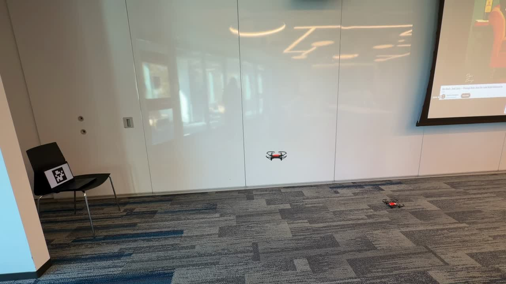
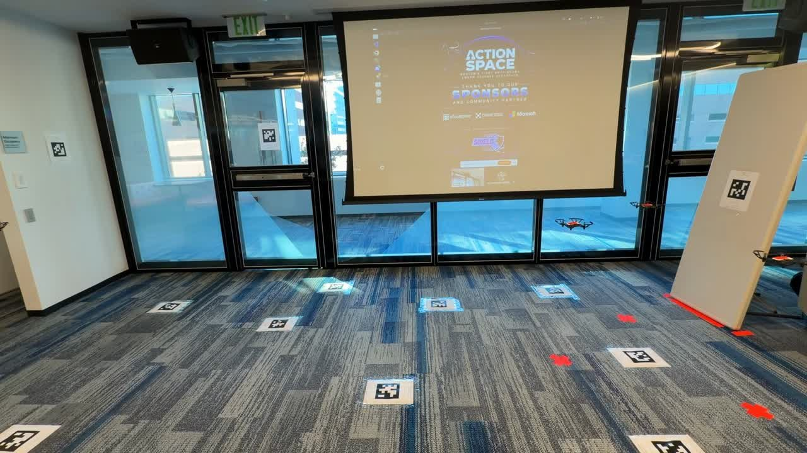
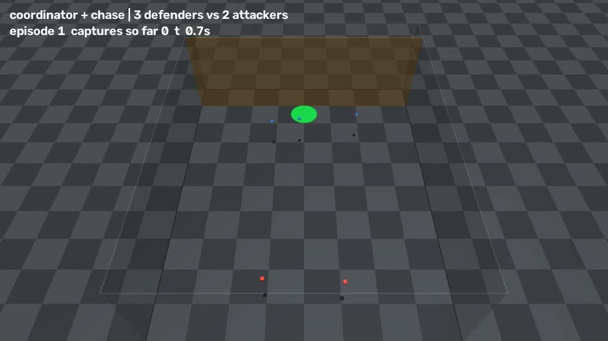
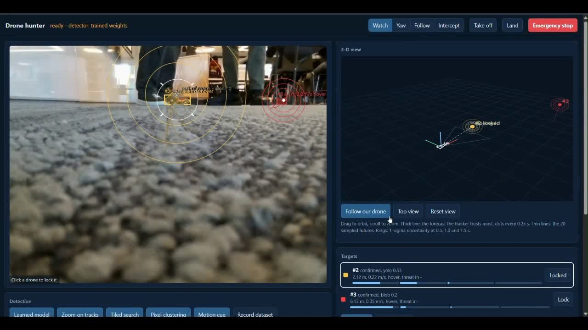

# Judges' presentation: what it covered

The Team 5 presentation at the Action Space hackathon ("Counter Anti Drone Swarm Technology", 8 slides). Here is each slide's content, with its images where the slide had them.

| # | Slide | Content |
|---|---|---|
| 1 | **Title** | Action Space Hackathon: Frania, Sai, Alay, Dhyey, Team 5 |
| 2 | **Methodology** | The deployed system. Three Tellos fly autonomously using only their onboard cameras and the AprilTag map. A 10 Hz planner assigns defenders to the closest, most urgent attackers, with hysteresis. Assigned defenders ram at full speed while a spare guards the line to the table. Safety: speed cap, geofence, tag-loss search, and auto-landing on low battery, link drop or Ctrl-C. Shown with our browser GUI ([details](../drone_deployment_infra/our_defense/)). |
| 3 | **Demo** | Video of the real flight at the venue |
| 4 | **Implementation** | The arena: floor and wall AprilTags, the defended area, the drones |
| 5 | **Sim-to-sim validation** | Coordinated pursuit with an optional PPO residual, built in MuJoCo and validated unchanged in Isaac Lab ([details](../approaches/sim_to_sim_rl/)). Video of the MuJoCo 3 vs 2 run. |
| 6 | **Sim-to-sim results** | 0% breaches over 800 episodes, against 75–89% for the greedy baseline; 7.5% with realistic sensing ([table](../approaches/sim_to_sim_rl/#results-isaac-lab-as-defend-v0-200-episodes-per-row-20-hz-headless-on-an-h100)) |
| 7 | **Visual servo defend** | Camera-only defense: auto-labelled YOLO26 segmentation, depth-aware tracking, a Social-GAN-style forecaster; 3/3 intercepts in simulation ([details](../approaches/visual_servo/)). Video of the "Drone hunter" interface. |
| 8 | **Thank you** | |

| Demo: real flight at the venue (slide 3) | Implementation: the arena (slide 4) |
|---|---|
|  |  |

| Sim-to-sim: MuJoCo 3 vs 2 (slide 5) | Visual servo: Drone hunter (slide 7) |
|---|---|
|  |  |

The images above are stills: the exported slides keep only one frame of each video. The full videos of the MuJoCo simulation and the visual-servo demo will be added to their folders under [`approaches/`](../approaches/).
