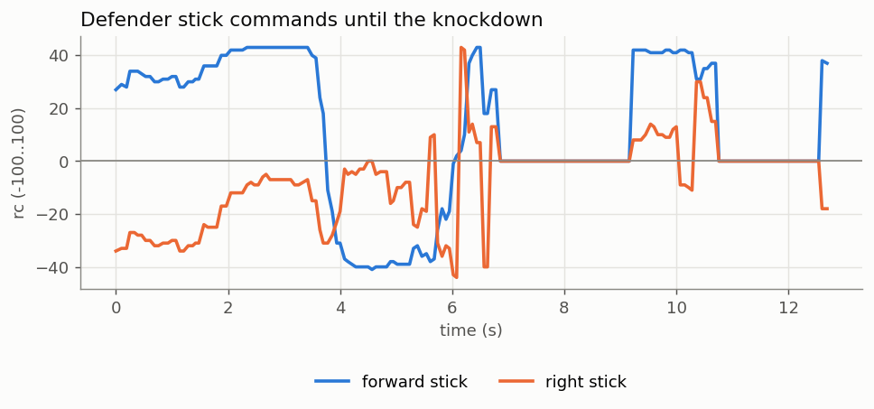
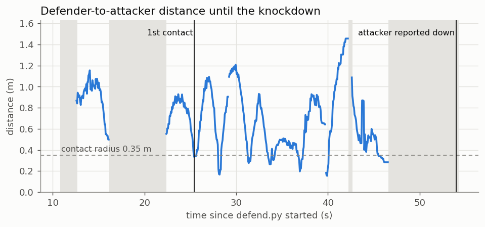

# Results

All numbers come from the logs in [`results/data/`](results/data/) and [`results/sim_benchmark.csv`](results/sim_benchmark.csv). The HTML reports are self-contained (charts and video frames embedded): download one and open it in a browser. They were made with [`make_report.py`](../drone_deployment_infra/our_defense/make_report.py).

## Real flights

### TELLO-2 (defender) vs TELLO-4 (attacker): venue, 24 Oct 2026

Report: [`results/duel_TELLO-2_vs_TELLO-4.html`](results/duel_TELLO-2_vs_TELLO-4.html) · log: [`defend_20261024_092802.jsonl`](results/data/defend_20261024_092802.jsonl)

| | |
|---|---|
| First contact (within 0.35 m) | **3.6 s** after the defender started |
| Closest measured pass | **0.18 m**, at 6.4 s |
| Attacker reported down | **12.4 s**. Its own camera shows the hit at about 12.5 s and the carpet by 16 s. |
| Attacker feed | 14 Hz, median report age 110 ms |




Timeline:
1. **0–3.6 s:** the defender rams from 1.0 m away and enters the contact radius at 3.6 s.
2. **3.6–12.4 s:** it overshoots (the Tello coasts), turns back and passes again within 0.18 m. While it's right behind the attacker, the attacker blocks its view of tag 10 (grey bands). Each time the defender holds still instead of flying blind, then resumes.
3. **12.4 s:** the attacker is down. The defender drops the target and returns to its holding spot.

### TELLO-9 (defender) vs TELLO-6 (attacker): home, single tag 10

Report: [`results/duel_TELLO-9_vs_TELLO-6.html`](results/duel_TELLO-9_vs_TELLO-6.html) · log: [`defend_20261024_143630.jsonl`](results/data/defend_20261024_143630.jsonl)

This run used the final `defend.py` (instant takeoff, advance toward tag 10, aim at the current position), with `dummy_attacker.py` flying TELLO-6 back and forth 0.5 m toward and away from tag 10.
- **The defender kept re-attacking:** first contact at **25.4 s**, then several passes at **0.17–0.28 m** between 25 s and 47 s.
- **The attacker's camera shows it flipped at about 40 s**, after which its video ends. Its feed reported it down at **54 s**.



Across the four home duels between these two drones, the two with a logged contact both ended with the attacker down.

### Motion check: TELLO-2, home

`axis_check.py` takes off facing tag 10, hovers with zero sticks, then pulses each axis at rc 30 for 1.5 s. It measures the real motion with the tag, in the drone's own axes. Log: [`axis_check_TELLO-2_20261024_000632.jsonl`](results/data/axis_check_TELLO-2_20261024_000632.jsonl)

| Segment | Sticks (r, f, u, yaw) | Moved right / fwd / up (m) | Verdict |
|---|---|---|---|
| hover | (0, 0, 0, 0) | -0.12 / -0.08 / +0.03 | holds still |
| forward | (0, 30, 0, 0) | +0.01 / +0.10 / +0.00 | correct direction |
| hover | (0, 0, 0, 0) | +0.01 / +0.14 / +0.03 | still moving forward (coast) |
| back | (0, -30, 0, 0) | +0.04 / -0.41 / -0.07 | correct direction |
| hover | (0, 0, 0, 0) | -0.01 / -0.67 / -0.11 | still moving back (coast) |
| right | (30, 0, 0, 0) | +0.09 / +0.02 / +0.08 | correct direction |
| hover | (0, 0, 0, 0) | +0.59 / -0.28 / -0.18 | still moving right (coast) |
| left | (-30, 0, 0, 0) | -0.28 / -0.24 / +0.01 | correct direction |
| hover | (0, 0, 0, 0) | -0.72 / -0.07 / -0.08 | still moving left (coast) |

- **Every axis moves the commanded way.** Each "hover" after a pulse keeps going in the pulse's direction: the Tello **coasts for about 2 s**.
- **A rc-30 pulse moves the drone 0.7–1.0 m in total**, about 2–3× the controller's assumption. That's why defenders overshoot and come back for another pass.
- **The run ended on its lost-tag safety.** The last pulse carried the drone out of the tag's view, so it landed instead of continuing.

## Simulation benchmark

[`sim_benchmark.py`](../drone_deployment_infra/our_defense/sim_benchmark.py) plays rounds between `hil_gui.py`, the attacker simulator, and the real `defend.py` brain driving kinematic defenders. Each round:
1. reset the scene;
2. let the defenders settle into the V in front of tag 23 (the table sits behind it);
3. launch both attackers from tag 10's side toward the table, straight or weaving.

The round ends when every attacker is down (a defender within 0.35 m), one reaches the table (a breach), or after 30 s.

Three defenders against two attackers, 5 rounds per setting, default settings (aim at the current position):

| Attacker speed (m/s) | Weave | Rounds | Knocked down | Breaches | First down (s) | All down (s) |
|---|---|---|---|---|---|---|
| 0.3 | 0 | 5 | 10/10 | 0 | 5.0 | 5.1 (max 5.2) |
| 0.3 | 0.6 | 5 | 10/10 | 0 | 5.0 | 5.1 (max 5.2) |
| 0.5 | 0 | 5 | 10/10 | 0 | 3.9 | 3.9 (max 3.9) |
| 0.5 | 0.6 | 5 | 10/10 | 0 | 3.9 | 3.9 (max 4.1) |
| 0.8 | 0 | 5 | 10/10 | 0 | 2.9 | 2.9 (max 2.9) |
| 0.8 | 0.6 | 5 | 10/10 | 0 | 2.8 | 3.0 (max 3.1) |


**Total: 60/60 attackers knocked down, 0 breaches in 30 rounds.** The simulated defenders localize perfectly and respond with a 0.3 s first-order lag. That tests the strategy (assignment, goalkeeper, formation, aim), not the real flight dynamics.

Reproduce:
```bash
cd drone_deployment_infra/our_defense
python3 sim_benchmark.py --python ../../.venv/bin/python
```

## Problems found in testing, and the fixes

| Symptom | Cause | Fix |
|---|---|---|
| Drone drifted into a wall | Dark room, and the tag shown on a glowing screen: no tag fix and no optical-flow position hold | Lights on and printed tags. Never fly blind: hover, yaw search, land on timeout. |
| Defender flew the wrong way sideways and vertically | The tag frame was mirrored: official prints are rotated 180° from OpenCV's drawing | `upright_positional.py` normalizes every tag to upright before applying the map |
| "Upside-down" landing at the venue | The map was stale (tags 2, 7, 11, 12 and 23 moved 1.5–2.5 m) | Readings that disagree with tag 10 are dropped at runtime; known-moved tags are ignored |
| One failed video grounded every defender | All-or-nothing preflight | Per-drone instant takeoff; video starts after takeoff and restarts by itself |
| `takeoff -> timeout` | Video `streamon` retries and the takeoff shared one command socket | One lock per drone; short single `streamon` attempts |
| Climbed out of the camera's view | Chased an attacker far above the tags | Height band of ±0.5 m around tag 10, and a fixed climb after takeoff |
| Aim far ahead of the attacker | Long prediction plus lag compensation | Default aim at the current position (`--max_lead_s 0`) |
